# bluesnap

A fast screenshot tool for Windows and macOS, written in Rust with [GPUI](https://gpui.rs).

| | |
|---|---|
| **Pick a window** under the cursor<br>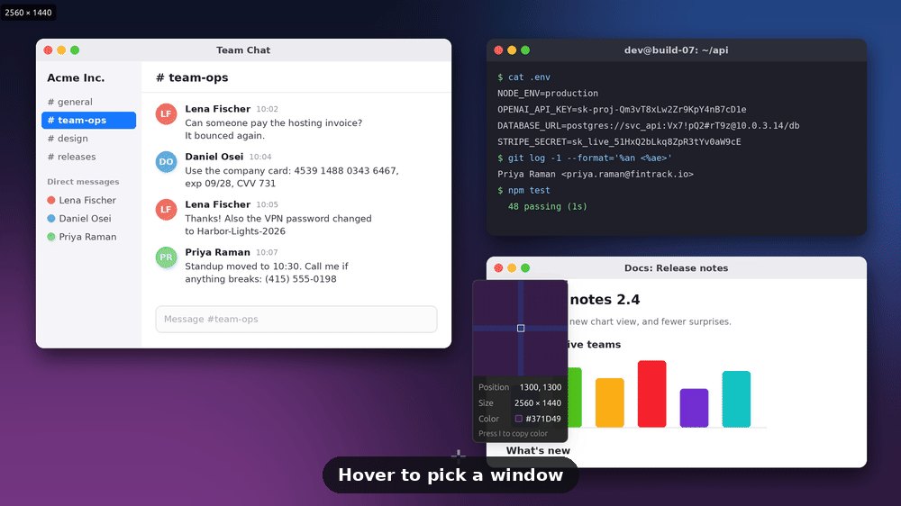 | **Drag a region**, then resize or move it<br>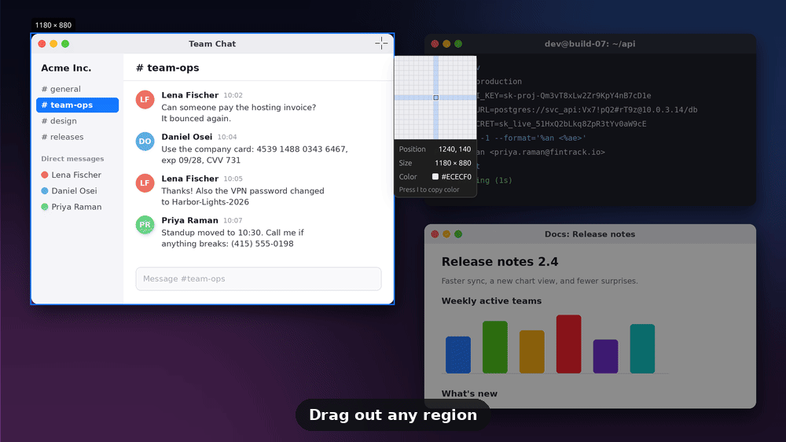 |
| **Loupe**: magnified pixels, position, size and color<br>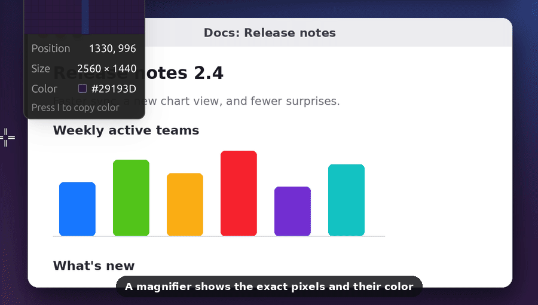 | **Shapes**: rectangle, ellipse, arrows (straight, elbow, curved), pen<br>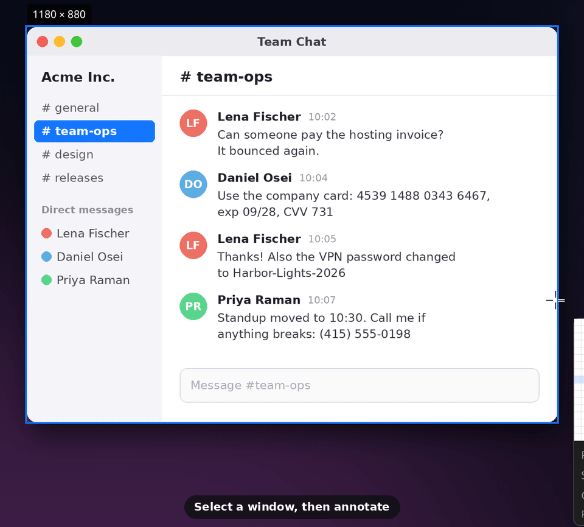 |
| **Text** in seven styles<br> | **Highlighter** with a chisel nib<br> |
| **Counter**: numbered markers<br>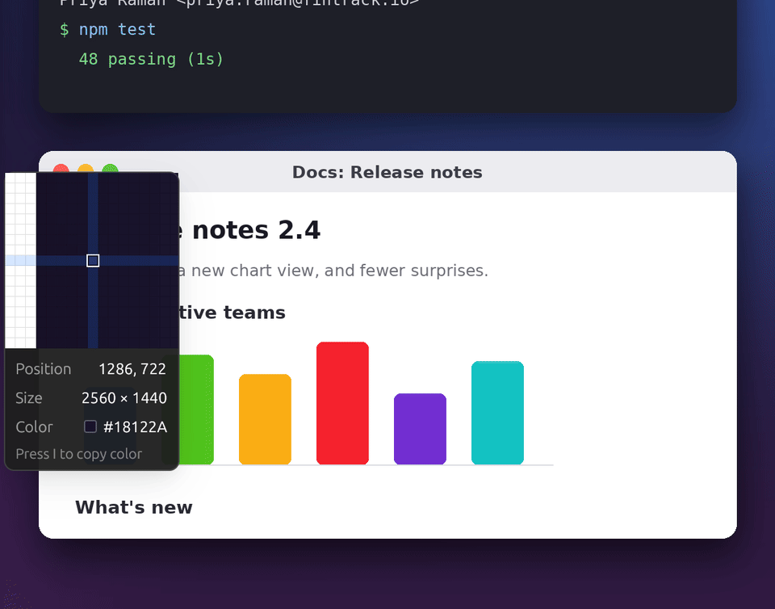 | **Redact** with mosaic, blur or gray<br>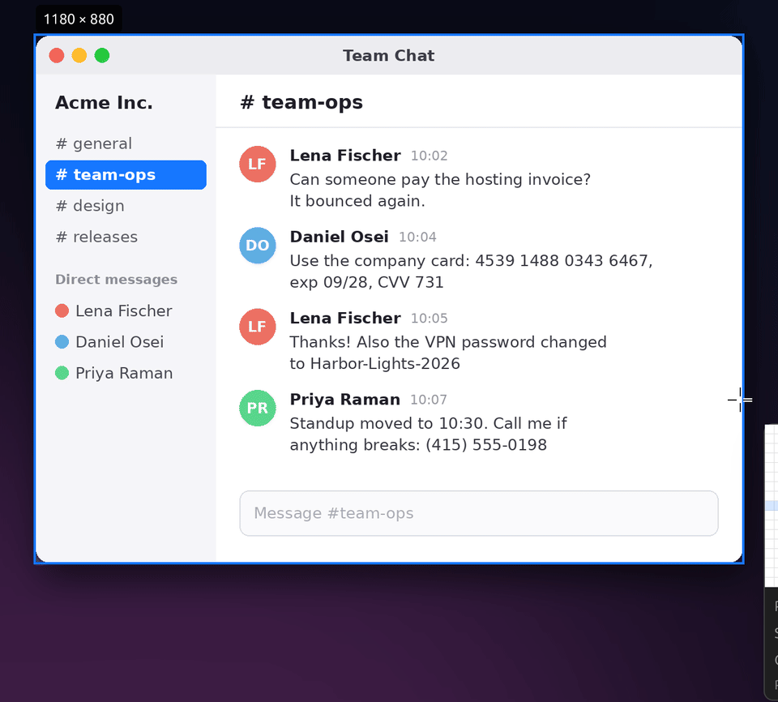 |
| **Auto redact** with AI<br>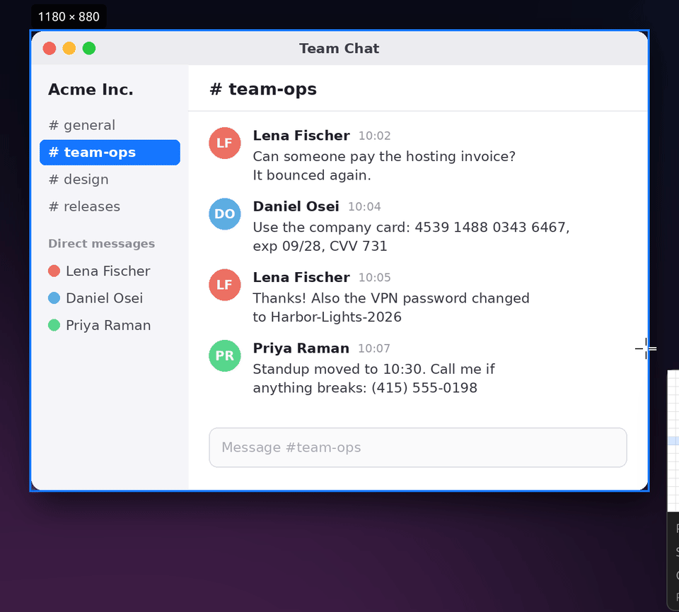 | **Scrolling screenshots**<br>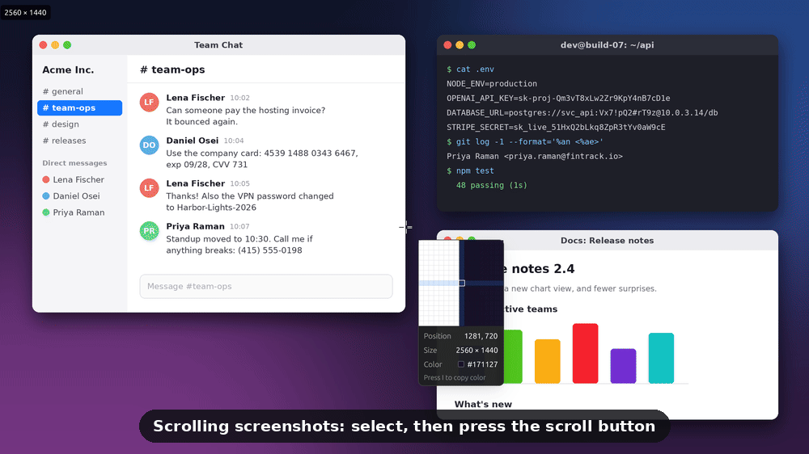 |
| **To text**: copy the text in the selection<br>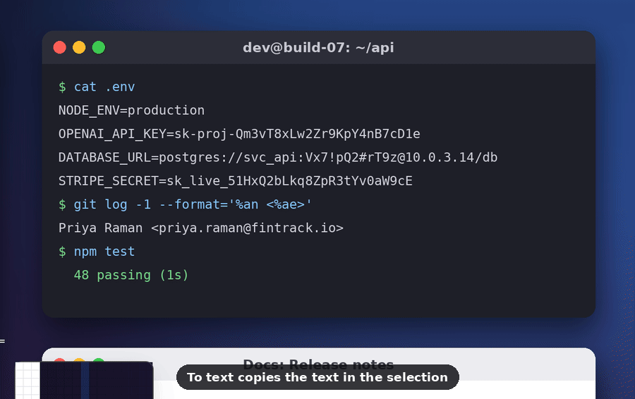 | **Composition Editor**: combine captures, resize & reorder layers<br>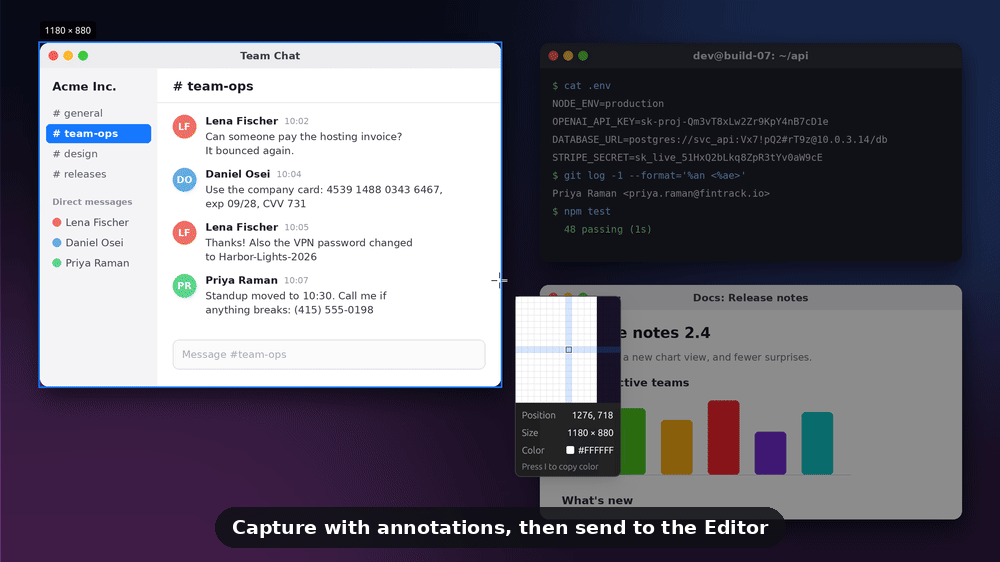 |
| **Canvas & background**: resize workspace, solid or transparent fill<br>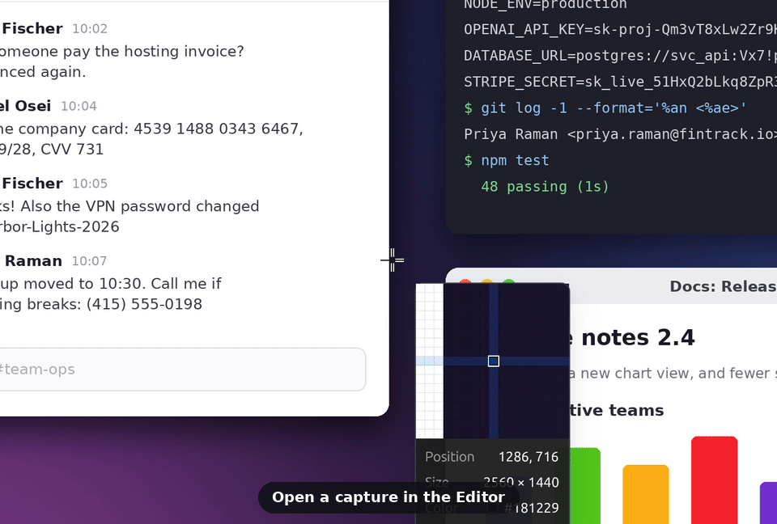 | **Copy & paste**: duplicate live annotations, paste images or text<br>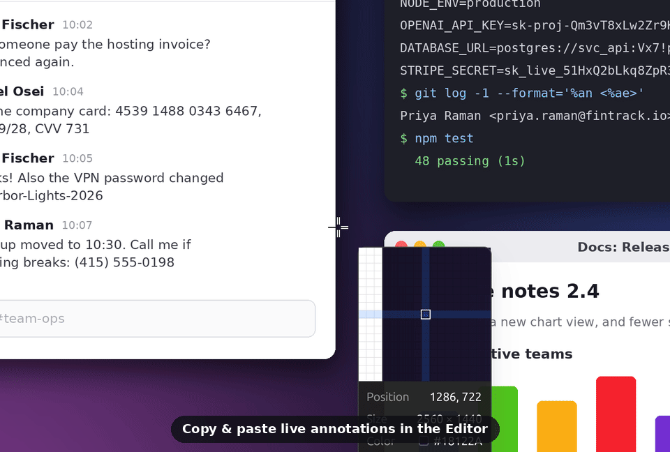 |

These are recorded from the real app by `demo/record.sh` (see
[Demo recordings](#demo-recordings)).

Press the hotkey, then:

- move the mouse: the window under the cursor is highlighted (blue border, size label)
- a loupe beside the crosshair magnifies the pixels under it (17 × 17, each
  8 px wide, the center one outlined) and shows the position in screen pixels, the
  size of what would be selected (the window under the cursor, or the region being
  dragged) and the color under the cursor. Press **I** to copy that color as
  `#RRGGBB`. The loupe stays on screen, flipping to the other side of the cursor
  near an edge, and goes away once a selection is made.
- click to select the window under the pointer, or drag to select a region.
  On macOS, bluesnap uses the window’s own corner pixels to preserve its shape
  and anti-aliased transparency. On Windows 11, it clips rounded corners and
  omits the translucent 1 px frame border. Moving or resizing a snapped
  selection turns it back into a rectangular crop.
- drag the 8 handles to resize the selection, or drag inside it to move it
- annotate with rectangle, ellipse, arrow, pen, highlighter, counter, redact and
  text. Click an existing
  annotation to select it, then drag it, drag its handles, change its size/color in
  the style bar, or press Delete. Ctrl/Cmd+Z undoes.
- **arrows** come in three styles, picked in the arrow style bar: **straight**,
  **elbow** (horizontal and vertical segments with rounded corners, like an elbow
  connector in a diagram: three segments along the longer side, such as left, up,
  left, turning halfway; an arrow whose jog or end segments would be too short to
  look right is drawn straight) and **curved** (an S curve that leaves the start
  and reaches the tip along the same axis). Changing the style of a selected arrow
  is one undo step.
- hold **Shift** while drawing, as in Paint: arrows and pen, highlighter and redact
  brush strokes become straight lines locked to one of eight directions (every
  45°), and rectangles, ellipses and redact areas become squares and circles.
  Pressing or releasing Shift mid-drag takes effect at once.
- the **highlighter** draws translucent strokes (yellow by default) with an upright
  chisel nib, like a real highlighter: narrower than tall, so horizontal strokes
  are full height and vertical ones thin, with squarish rounded ends. Strokes don't
  get darker where they cross; hold Shift for a straight line, handy for a line of
  text. The nib's outline under the pointer shows its size.
- **text** comes in the seven styles CleanShot X offers, picked in the text style
  bar (each shown as a preview in the current color): Standard, Rounded,
  Monospaced, Outlined (a contrasting outline, readable on any background), Boxed
  (on a box of the text color), Rounded Boxed (on a pill) and Monospaced Boxed (on
  a bordered card, like a code chip). Text is bold-ish, in SF Pro / SF Pro Rounded /
  SF Mono on macOS and Segoe UI Semibold / Nunito / Consolas on Windows. Changing
  the style of selected text is one undo step.
- the **counter** places numbered markers with a click (drag to position before
  releasing): 1, 2, 3 … or A, B, C …, I, II, III … or a, b, c …, chosen in its
  style bar for the whole sequence. Deleting one renumbers the rest; drag a
  marker to move it. Labels are dark on light colors.
- the Redact tool's style bar picks how to hide things: paint with a **brush** (a
  ring under the pointer shows its size) or drag an **area**; then **mosaic**,
  **blur** or a solid **gray** block. The slider sets the mosaic block size or
  the blur strength, and dragging it updates the selected redaction live (one
  undo step per drag). Select an existing redaction to change its effect or
  strength; area redactions can be resized with their handles. Effects always
  read the original screenshot, and mosaic blocks line up across strokes.
- the Redact bar's **Auto** button finds passwords, keys, tokens, contact details,
  IDs and card numbers in the selection with AI (see [AI features](#ai-features))
  and covers each with an area redaction in the current effect, in about a second.
  One undo removes them all. A toast shows each step (reading the text, checking
  it with AI, the result) and any error; without a model set up, it offers to
  open AI Settings.
- the "To text" button (left of Save; text lines inside scan corners) recognizes the text in the selection,
  copies it to the clipboard as plain text and closes. Redacted areas stay unreadable
  because recognition runs on the image as shown.
- **Add to editor** (next to Save) sends the captured image and its unflattened
  annotations into the **Composition Editor** — opening a new editor window sized to
  the first image if none is open, or appending into the existing editor session. In
  the editor:
  - every placed screenshot and every annotation from earlier steps stays live: click
    any image or shape to move it, resize it with its 8 handles (hold **Shift** on a
    corner handle to lock an image's aspect ratio), restyle it, reorder it forward or
    backward, or delete it
  - drag any edge or corner of the canvas itself to grow or crop the composition
    workspace (with full undo across canvas resizes, image moves/resizes and shapes),
    or right-click exposed canvas background to pick a **Background color** (solid
    swatches, transparent checkerboard, or native OS color picker), saved in `.bs`
  - click **Add image** on the far left of the toolbar to hide the editor temporarily
    and capture another screenshot; **✓** adds that capture straight into the editor
  - **Ctrl/Cmd+C** copies the selected image or annotation. With nothing selected,
    it copies the whole canvas. **Ctrl/Cmd+V** pastes an editable BlueSnap annotation,
    an image from another app, or plain text. **Ctrl/Cmd+Z** removes the pasted layer in one step.
    Copying an item covered by a redaction gives you the visible, flattened pixels.
  - click **Open** (next to Add image) to load a saved `.bs` composition or image file,
    or double-click any `.bs` file in Explorer / Finder (`bluesnap <file.bs>` opens a
    standalone editor session without conflicting with a running tray instance)
- the scrolling-screenshot button (a page with a down arrow) captures more than fits
  on screen: the overlay closes, a blue frame marks the selection, a live preview
  beside its bottom edge grows upward (shrinking in width once it nears the top of
  the screen) to show the stitched result so far, and a bar shows progress. Scroll
  the window under the frame (mouse wheel or trackpad; input passes
  through the frame) and bluesnap captures it about 16 times a second, stitching the
  frames into one tall image. Sticky headers and footers appear once. The bar
  next to the region has Add to editor, Save, ✕ and ✓: ✓ (or the hotkey again) copies the
  image, Save writes a `.png` or `.bs` file, ✕ cancels, and Add to editor sends the
  stitched image and annotations into the Composition Editor, scrolled with the mouse
  wheel (Ctrl/Cmd+wheel zooms). Scroll at a moderate
  pace: if a frame shares nothing with the previous one the bar says so, and
  scrolling back a little picks it up again. Content redrawn at fractional pixel
  offsets (display scaling, trackpads) is matched with sub-pixel accuracy.
  The stitched image keeps the full width of the selection, including fixed side
  panels and scrollbars. Annotations made before capture stay on the selected
  content and remain editable in the editor. The image stops at 30,000 px.
- In the capture overlay, ✓ (or Enter, Ctrl/Cmd+C, double-click) copies a plain raster image to the
  clipboard; the download icon (or Ctrl/Cmd+S) saves either a `.png` image or an
  editable BSON-based **`.bs`** file (storing lossless raw image data, canvas size and
  all live elements so it can be reopened and edited later); ✕ (or Esc) cancels.
  Right-click goes back to window picking, or exits when nothing is selected.

bluesnap lives in the system tray (Windows) or menu bar (macOS). Its menu has
Take Screenshot, Open Editor, Open .bs File…, Edit Settings…, AI Settings…, a
start-at-login check item and Quit;
on Windows, left-clicking the tray icon also takes a screenshot. The check item,
**Start with Windows** (a `bluesnap` value in
`HKEY_CURRENT_USER\Software\Microsoft\Windows\CurrentVersion\Run`) or **Open at
Login** on macOS (`~/Library/LaunchAgents/com.kevinwang15.bluesnap.plist`), starts
bluesnap when you log in. It's off by default. If the app has been moved, the entry
is pointed at the new location the next time it runs.

Default hotkey: **Ctrl+Alt+A** on Windows, **Ctrl+Cmd+A** on macOS. It is set in
`config.toml`, created on first run in the OS config directory
(`%APPDATA%\bluesnap\` on Windows, `~/Library/Application Support/bluesnap/` on macOS).
If bluesnap ever crashes, the details are appended to `crash.log` in the same
folder.

## AI features

Optional, and off until set up in **AI Settings…** in the tray / menu bar menu.
Two services can be configured, each with a URL (like `https://api.example.com`),
token and model; either or both:

- an **LLM** behind an OpenAI-compatible Responses API (`/v1/responses`);
- a **decision model** behind a Decisions API (`/v1/decisions`).

Each section has a Test button. The settings are saved to `ai.json` beside
`config.toml`, readable only by the user (it holds the tokens).

### Auto redaction

Text is recognized locally on the computer with the same OCR as To text, while (when
an LLM is configured) a compact thumbnail is analyzed in parallel so the models know
what kind of screen or dashboard is shown and which figures or identifiers are
confidential in context. Tall images (scrolling screenshots) are read in bands of
1200 rows, with progress in the toast; recognition, about 1 s per 1000 rows of dense
text at 900 px wide, runs concurrently with the screen-context step. Recognized lines
are then checked in reading order alongside that screen context, 8 per LLM request
and one per decision request, all in parallel (up to 16 at a time per model; busy
responses are retried). Each finding is then placed on the screen: the line's words
are matched to the clusters of ink in the pixels, so boxes fit the actual glyphs in
any font, descenders included.

How this was chosen: 12 synthetic screenshots (settings page, terminal, chat,
Chinese form and chat, config file, email, bank page, code diff, admin table, and
two with nothing sensitive) with 48 known sensitive spans, scored by the share of
spans covered and the share of redacted area that is sensitive:

| approach | found | precision | time |
|---|---|---|---|
| screenshot image to the LLM, asked for boxes | 8–12% | — | 27 s |
| OCR lines to the LLM, reasoning on | 100% | 92% | 2–4 s |
| **OCR lines to the LLM, no reasoning, 8 lines per request** | 96–100% | 95% | 0.4 s |
| OCR lines to the decision model, one per line | 96% | 69% | 0.5 s |
| **both: decision model adds lines it is sure about** | 98–100% | 93% | 0.4 s |

(Times are for the AI requests after OCR, with DeepSeek V4.1 Flash and d3-ultra.)
The image route places boxes far from the text; local OCR boxes are exact, so no
extra model is downloaded. The decision model alone redacts whole lines minus a
short label, so it works best next to an LLM.

## Layout

```
crates/
  core/       bluesnap-core: no OS or UI code. Unified Editor & Composition engine
              (window picking, resizable canvas, placed images, annotations, Z-order,
              undo, text editing), BSON 1.1 `.bs` file format, tiny-skia rasterizer
              and scrolling-screenshot stitcher.
  platform/   bluesnap-platform: every OS API call, behind the `Platform` trait.
              windows.rs  GDI capture, EnumWindows + DWM window bounds, topmost overlay,
                          Win32 `.png` / `.bs` save & open dialogs
              macos.rs    CoreGraphics capture and window list, AppKit overlay & panels
              linux.rs    stub (builds, capture returns an error) plus demo mode
  ocr/        bluesnap-ocr: embedded PP-OCRv6 models (small det + medium rec) run by tract.
  ai/         bluesnap-ai: optional AI endpoints (settings, Responses / Decisions API
              calls) and finding sensitive text in OCR lines for Auto redaction.
  app/        bluesnap: the GPUI frontend.
              canvas_view.rs    first-class canvas view shared by the capture overlay
                                and the multi-image Composition Editor
              capture.rs        configurable capture entry point (Standard / ForEditor)
              editor_window.rs  Composition Editor session & `.bs` / image file loader
              scrolling.rs      scrolling capture session (dim layer, bar, stitching loop)
              toolbar.rs        reusable toolbars, style bars, and layer-order controls
              viewport.rs, gpu_image.rs  image <-> window mapping, tiled GPU atlases
              output.rs         clipboard copy and `.png` / `.bs` save dialog
              ai_settings.rs    the AI Settings window; text_field.rs  its text inputs
packaging/          app icons (generated, source in packaging/icon), macOS Info.plist
crates/platform/assets/fonts  Nunito (SIL Open Font License, Nunito-OFL.txt), the
                    rounded text face on Windows and Linux
third_party/xattr   patched copy of a gpui dependency (see below)
```

Text recognition is per OS: macOS uses the built-in Vision framework (Simplified and
Traditional Chinese plus English), Windows uses embedded PP-OCRv6 models (`small`
detection + `medium` recognition, covering Simplified/Traditional Chinese, English,
Japanese and 46 Latin-script languages). The models are only compiled into non-macOS
builds; with `float16` weight storage on the recognizer they add about 48 MB to the
binary (about 36 MB compressed).

The capture happens before the overlay window opens. The overlay shows the frozen
screenshot, so the image is exactly what was on screen when the hotkey was pressed.

Adding Linux means implementing `Platform` in `crates/platform/src/linux.rs`
(X11 `GetImage` + `_NET_CLIENT_LIST_STACKING`, or the XDG screenshot portal on Wayland).

## Building

```
cargo run --release -p bluesnap
```

- **Windows**: MSVC toolchain. Release builds of gpui compile shaders with `fxc.exe`
  from the Windows SDK (set `GPUI_FXC_PATH` if it isn't found).
- **macOS**: Xcode (gpui compiles Metal shaders). CI builds `bluesnap.app`
  (menu bar app, no Dock icon) and uploads it zipped.

### macOS Screen Recording permission

macOS shows only the wallpaper (or plain gray) in place of windows until bluesnap
has Screen Recording permission. bluesnap shows a banner with an "Open Settings"
button when the permission is missing.

The complete app bundle must be code-signed, but an Apple-issued identity is not
required for local use. CI ad-hoc signs the app when no certificate is configured;
local builds can do the same:

```bash
codesign --force --sign - bluesnap.app
codesign --verify --deep --strict --verbose=2 bluesnap.app
```

A "Developer ID Application" or "Apple Development" identity is still recommended
for distribution and can preserve permission grants across rebuilds. For local
builds, pass that identity to `codesign` instead of `-`. CI accepts these repository
secrets:

- `MACOS_CERTIFICATE_P12`: base64 of a `.p12` containing the certificate and key
- `MACOS_CERTIFICATE_PASSWORD`: the `.p12` password
- `MACOS_SIGNING_IDENTITY`: for example, `Developer ID Application: Your Name (TEAMID)`

Open the app, enable it under System Settings → Privacy & Security → Screen &
System Audio Recording, and restart it from the menu bar icon (Quit, then reopen).
Ad-hoc permission grants can be tied to a build's code hash, so rebuilds may require
re-enabling permission. If an old entry gets in the way:
`tccutil reset ScreenCapture com.kevinwang15.bluesnap`.
- **Linux**: builds for development (needs `libxkbcommon-x11-dev` and friends), but
  capturing isn't implemented.

`cargo test --workspace` runs the editor, geometry, layout and rendering tests.
`RUST_LOG=bluesnap=debug` logs capture and overlay timings.

### Demo recordings

`demo/record.sh [scene ...]` builds the app and re-records the GIFs in
`docs/demo/` (all of them by default, about 5 minutes). It runs on Linux and
needs Xvfb, xdotool, ImageMagick, ffmpeg and Python 3 with Pillow, NumPy and
Tk. The app runs on a private virtual display in demo mode: it "captures" a
fake desktop drawn by `demo/desktop.py` and reports where its buttons are, so
the scenes in `demo/scenes.py` click controls by name. The Auto redact scene
needs `BLUESNAP_DEMO_AI_URL`, `BLUESNAP_DEMO_AI_TOKEN` and
`BLUESNAP_DEMO_AI_LLM` and/or `BLUESNAP_DEMO_AI_DECISIONS`; without them it's
skipped. Scratch files go to `demo/out/`.

## Performance

`cargo bench -p bluesnap-core` measures the hot paths (4K screen, full-screen
selection, 20 annotations). On a 20-thread x86 Linux machine:

| benchmark | time |
|---|---|
| capture buffer → GPU image + editor copy | 3.3 ms |
| frame while drawing with the pen | 0.6 ms |
| frame while moving the selection | ~0 (no re-render) |
| frame while typing text | 0.7 ms |
| export (copy/save) | 7 ms |
| first mosaic stroke | 1.0 ms |
| frame while drawing a 600-point highlighter stroke | 2.6 ms |
| re-rendering 55 annotations of every kind (after committing one) | 10 ms |
| frame while dragging the blur slider (1200×800 area) | 11 ms |
| blur of 1000 rows of a 1600×30000 scrolling screenshot | 5 ms |
| stitching one 1600×1000 frame of a scrolling capture | 5 ms |

Annotations are split into a cached layer of finished shapes and a small layer for
the shape being edited; both are clipped to the selection on the GPU, so only the
edited shape is re-rasterized and uploaded per mouse move. With
`RUST_LOG=bluesnap=debug` the app logs a timeline from hotkey to first presented
frame (65–115 ms under WSLg, most of it gpui window creation and the first frame).

Fonts are memory-mapped and each face is loaded once, shared by the three
families: large CJK fallbacks (tens of MB each) cost no private memory, where a
copy per family took about 50 MB more on Linux and far more on macOS and Windows.

Redaction effects are computed in 256×256 tiles, only under redactions, in
parallel, and cached for the four most recent effect settings, so slider drags
and very tall images stay responsive. The blur's horizontal passes run down the
columns of the transposed tile, which vectorizes, and use AVX2 when the CPU has it.

On macOS, opening the capture overlay starts warming Vision in the background so
its model loading usually finishes before you use To text.

Text recognition with the embedded models (Windows) caps detection on large high-DPI
captures at their logical size (at least 1600 px) while always cropping recognition
lines from the full-resolution image, so small UI text and dense CJK strokes stay
sharp across any display scale. The `PP-OCRv6_medium` recognizer is compiled once
with a symbolic width dimension, keeping memory around 0.2–0.5 GB without per-width
plan recompilation, and unloads after a minute idle.

## Known limitations

- Only the display under the cursor is captured.
- macOS capture uses `CGDisplayCreateImage`, which Apple deprecated in favor of
  ScreenCaptureKit (much slower for a single frame). If a future macOS removes it,
  `macos.rs` is the only file to change.
- On Linux/X11, the `global-hotkey` crate misses a hotkey press made within about a
  second of closing the overlay. Windows and macOS use different hotkey backends.
- `third_party/xattr` patches xattr 0.2.3 (pulled in by gpui 0.2.2), which fails to
  compile on Linux against current `libc`. It is unused on Windows and macOS builds.
